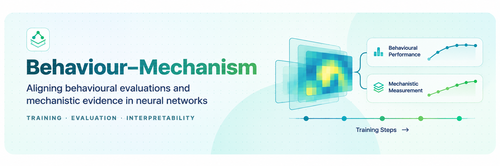
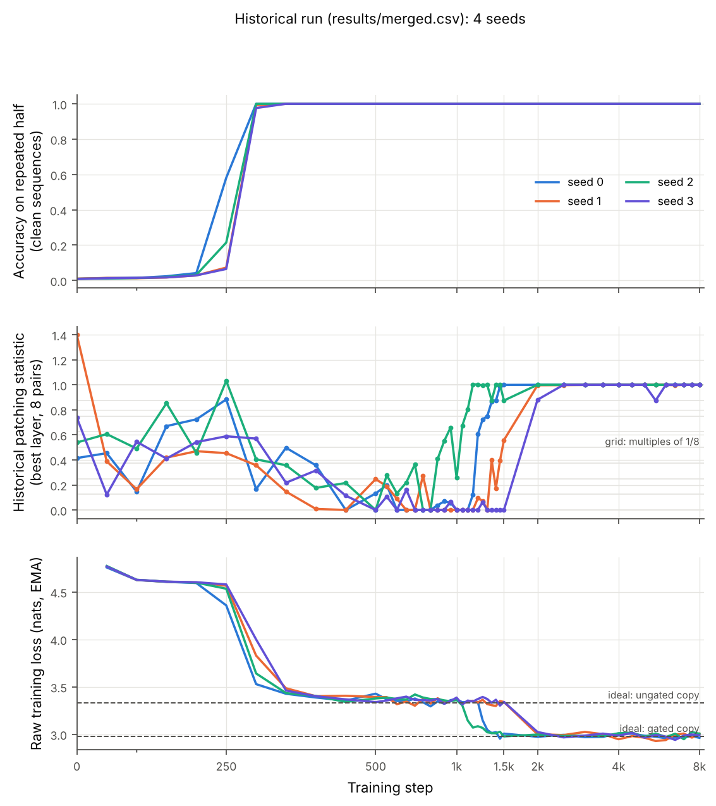
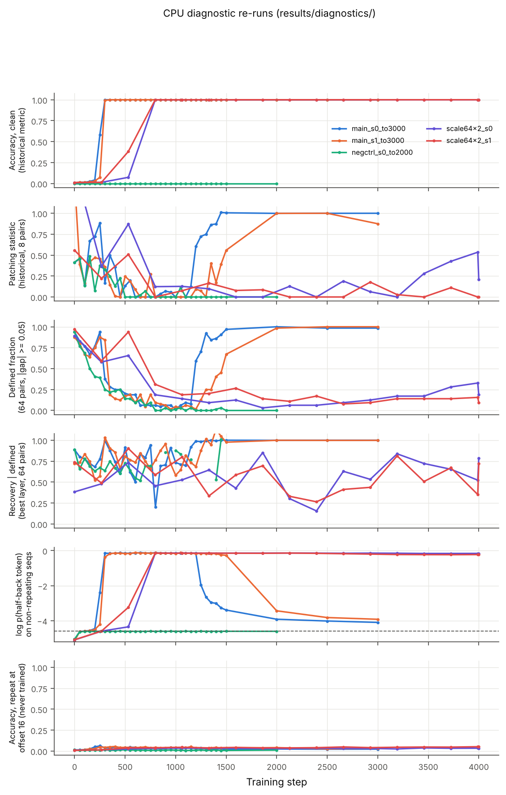

<p align="center">
  
</p>

# Behaviour–Mechanism

A small, fully inspectable study of how a behavioural metric and an activation-patching
metric of the same learned capability evolve during transformer training. The repository
contains the original experiment (a JAX/Flax notebook, checkpoint-level CSVs, a
preprint), an audit of what those artifacts do and do not establish, a tested Python
package that reproduces the measurement pipeline, and CPU diagnostic re-runs.

> **Status (November 2026).** The audit ([`docs/RESEARCH_AUDIT.md`](docs/RESEARCH_AUDIT.md))
> substantially revises the original interpretation. The historical numbers are
> reproduced, but they do not show that a *mechanistic* measurement stabilises later than
> behaviour. They are better explained by two behavioural transitions on two different
> input distributions. The preprint (September 2026) predates this audit.

## Research question

When a behavioural score and a causal mechanistic probe track the same learned capability
across training, do they agree about *when* the capability has stabilised?

## Motivation

Evaluations are often read as evidence about what a model has learned internally. If a
behavioural score and a mechanistic measurement can disagree about when learning is
complete, the disagreement itself is something to understand. That requires
knowing what each measurement actually measures.

## Hypotheses

- **Original (notebook §0):** H0, behavioural and mechanistic stabilisation coincide
  (T_b ≈ T_m); H1, they differ (T_b ≠ T_m).
- **Added by the audit, testable with existing artifacts:** H-align, the patching
  statistic's late rise coincides, seed by seed, with the model learning to *stop
  copying* on non-repeating sequences, a behavioural change that the original
  behavioural metric does not measure.

## Experimental setup

| | |
|---|---|
| Model | pre-LN decoder-only transformer, 4 layers × 4 heads, d_model 128, d_ff 512 (about 0.8 M parameters) |
| Task | vocabulary 100, length 64; with p = 0.7 the sequence is `[c, c]` for a random 32-token chunk `c`, otherwise uniform random tokens |
| Training | AdamW, lr 3e-4 with warmup 100 and cosine decay over 8,000 steps; repeat positions up-weighted ×3 in the loss; seeds 0–3; Colab T4 |
| Checkpoints | every 50 steps to 1,500, then every 500 (no checkpoints between 1,500 and 2,000) |
| Behaviour | argmax next-token accuracy on the repeated half of *clean* repeat sequences |
| Patching statistic | 8 clean/corrupted pairs per checkpoint (corrupted = random second half). Recovery = (lp_patched − lp_corrupt) / (lp_clean − lp_corrupt) for each layer's attention output at the read position. Pairs with \|gap\| < 0.05 are skipped and **count as 0**. Report the best layer. |
| Controls | negative control (no repeats, 2 seeds); scale scan (64/2, 128/4, 256/4; 2 seeds; 4,000 steps) |
| Real-text track | 1-, 2- and 3-layer attention-only character models on *Pride and Prejudice*, 3,000 steps, 1 seed |

The exact configuration is [`configs/config.json`](configs/config.json). It hashes to
`57c45749eb6d`, the hash printed by the notebook run that wrote `results/`.

## Verified findings

Every item is recomputed by `bm verify-artifacts` or measured in `results/diagnostics/`.
Details and evidence paths are in the audit.

1. **The historical numbers reproduce.**
   - Accuracy saturates at step 300–350 in all 4 seeds.
   - Under the preprint's sustained-ceiling criterion, the patching statistic settles at
     step 2,000 (θ 0.80–0.88) or 2,500 (θ 0.89–0.99).
   - CPU re-runs with the extracted code reproduce the historical patching statistic
     checkpoint by checkpoint: seed 0 to within 0.001 through step 1,400, and seed 1 to
     within 4e-6 through step 2,500. After that, GPU and CPU floating-point arithmetic
     diverge.
2. **The task does not require induction.**
   - The repeat is always at offset 32; the config's `induction_gap_*` fields are never read.
   - Accuracy exceeds 31/32 at every checkpoint from step 350. That means the model also
     predicts the *first* repeated token, which token-matching induction cannot do.
   - On repeats at offsets 8, 16 or 24, accuracy stays near chance (≤ 0.07) at every
     checkpoint of every CPU re-run.
   - The learned behaviour is fixed-offset copying, not general induction.
3. **The patching statistic is mostly a count of defined probe pairs.**
   - 41 of 176 main-run values and 56 of 88 negative-control values are exactly 0 because
     *all* 8 pairs were skipped: the measurement was undefined, not zero.
   - After step 300, 74% of values lie within 0.01 of a multiple of 1/8 (16% expected for a
     continuous quantity).
   - In the CPU re-runs, recovery *conditional on a defined pair* is noisy while few pairs
     are defined (0.2–1.1 on 1–26 of 64 pairs). It is about 1.0 once the gap opens. The late
     rise of the historical statistic follows the *defined fraction*.
4. **Pairs become defined when the model stops copying on non-repeating sequences.**
   - For about 900 steps after accuracy saturates, the model puts log-probability ≈ −0.15
     on the half-back token in *random* sequences: until step 1,200 for seed 0 and 1,400
     for seed 1. That is p ≈ 0.86, the optimum for an ungated copier under the ×3 loss
     weighting (0.875).
   - Clean and corrupted runs therefore look the same and the gap is about 0.
   - The log-probability then falls to about −3.9 by step 2,000–3,000, and the defined
     fraction rises to 1.
   - The 64/2 preset never makes this second transition within 4,000 steps. That explains
     its low historical value.
   - The negative-control model never copies at all, so from step 1,250 on, 0 of 64 pairs
     are defined.
5. **The same transition is visible in the historical training loss.**
   - Each seed's raw loss plateaus near the ungated-copy ideal (3.33 nats) and then drops
     to the gated-copy ideal (2.98).
   - That drop coincides with the patching statistic reaching 0.8: steps 1,350 / 1,350,
     2,000 / 2,000, 1,300 / 1,100 and 2,000 / 2,000 for seeds 0–3. This loss criterion
     is exploratory.
   - A loss-based behavioural metric would therefore have "stabilised" at the same time as
     the patching statistic.

<p align="center">
  
</p>

*Historical run, 4 seeds, from `results/merged.csv`. Middle: the patching statistic on a
1/8 grid. Bottom: raw training loss with the two idealised strategies (dashed).*

<p align="center">
  
</p>

*CPU diagnostic re-runs (`results/diagnostics/`). Rows: historical metrics; the fraction
of 64 pairs with a defined gap; recovery among defined pairs; log-probability of the
half-back token on non-repeating sequences (dashed = uniform); accuracy on repeats at an
untrained offset.*

## Interpretation

The original separation is real as a statement about two *numbers*. Once each number is
decomposed, the evidence supports a different account:

1. the model first learns to copy the token half a sequence back, everywhere;
2. later it learns to copy only when the sequence actually repeats.

The behavioural metric (argmax accuracy on clean repeats) sees only step 1. The
patching statistic is undefined until step 2 has happened, because the probe's corrupted
input *is* a non-repeating sequence. Layer-0 patching recovers most of the gap whenever
the gap exists.

So the historical result is best described as **"argmax accuracy on one input
distribution saturates before the model's behaviour on a second distribution changes"**.
It is not "behaviour stabilises before mechanism".

## Limitations

- One small architecture and one synthetic task. The task is solvable by positional
  copying, so nothing here is evidence about induction heads.
- 4 historical seeds; CPU diagnostics for 2 main-config seeds (truncated at step 3,000),
  2 seeds of the 64/2 preset and 1 negative-control seed. No confidence intervals are
  reported, because n is too small for them to mean much. Per-seed values are given instead.
- The ungated/gated account is supported by loss levels, log-probabilities and
  defined-fraction trajectories. It has **not** been confirmed by a constructed-weights
  control or alternative corruptions ([roadmap](docs/RESEARCH_ROADMAP.md) E3, E4).
- The sustained-ceiling criterion was chosen after seeing the data, and the checkpoint grid
  leaves T_m interval-censored to (1,500, 2,000].
- Head-level, logit-lens and real-text results have no saved numeric outputs and were not
  re-verified. The real-text "before" checkpoint is the untrained model.

## Reproducibility

Measured on a 2-vCPU Linux x86-64 workspace (Python 3.13, JAX 0.12 CPU).

```sh
pip install -e ".[dev]"
pytest -q                          # 23 tests, about 30 s
bm verify-artifacts --strict       # checks + derived tables from results/*.csv, seconds
bm figures                         # figures/derived/ from the CSVs
bm diagnose --seed 0 --stop-at 3000 --out results/diagnostics/my_run    # about 25 min on CPU
bm diagnostics-report              # summary.csv + diagnostics figure
```

| Level | What you can do | Cost |
|---|---|---|
| Tests and artifact checks | everything above except `diagnose` | under 1 min, CPU |
| Diagnostic re-run | any seed and config, with extra measurements | about 0.4 s per step (main model, 2 vCPU) |
| Full historical reproduction | 4 seeds × 8,000 steps + 2 negative-control seeds + scale scan | about 4–5 h CPU; the GPU run is not bit-reproducible on CPU after about step 1,400 |
| Not reproducible | historical checkpoints (never published), per-head and logit-lens numbers, real-text summary numbers | — |

The original notebook is kept unchanged as the historical record. It needs Colab and
Google Drive and fails elsewhere: `RESULTS_DIR` is undefined outside Colab. Use the package
instead; `tests/` checks that it matches the notebook (same batches, same step-0
metrics, same patching values).

## Repository structure

```text
assets/          header image
configs/         config.json — the historical main-run configuration
docs/            RESEARCH_AUDIT, RESEARCH_ROADMAP, UPGRADE_HANDOFF, PROVENANCE
figures/         historical figures (unchanged); figures/derived/ regenerated + new
notebooks/       behaviour_vs_mechanism.ipynb — historical, unchanged
paper/           behaviour_mechanism_preprint.pdf — September 2026, predates the audit
results/         historical CSVs (unchanged); derived/ checks; diagnostics/ CPU re-runs with manifests
src/behaviour_mechanism/  config, data, model, training, patching, probes, stability,
                 artifacts, figures, diagnose, provenance, cli
tests/           unit and regression tests (incl. exact matches to notebook outputs)
```

## Research roadmap

Completed: the original experiment (2026-09), this audit, and the CPU diagnostics. Next,
in order of information gain (details in
[`docs/RESEARCH_ROADMAP.md`](docs/RESEARCH_ROADMAP.md)):

1. pre-registered re-measurement with decomposed metrics over 8 seeds;
2. an offset-randomised task that actually requires induction;
3. alternative corruptions and interventions;
4. a constructed-weights positive control.

## AI safety relevance

The project is a worked example of a measurement-validity problem rather than a safety
result. Two metrics that both sound like "has the model learned X" disagreed. The
disagreement came from what each metric conditions on: an input distribution, and a
skip rule. It did not come from a hidden internal change. That matters for anyone who
reads a mechanistic measurement as a check on a behavioural evaluation. Decompose the
measurement first, and say which inputs each one covers. Nothing here is evidence about
frontier models or safety-relevant capabilities.

## Citation

The September 2026 preprint is archived on Zenodo
([doi:10.5281/zenodo.22602752](https://doi.org/10.5281/zenodo.22602752)). It is not peer
reviewed, and the audit revises its interpretation. If you use this repository, cite the
repository and note the audit date:

```bibtex
@misc{behaviour_mechanism_2026,
  author = {Aden, Hamda},
  title  = {Behaviour--Mechanism: behavioural and activation-patching measurements during small-transformer training},
  year   = {2026},
  note   = {Repository version with research audit, November 2026},
  url    = {https://github.com/hydrangeas20/behaviour-mechanism}
}
```

## References

- Olsson et al. (2022), *In-context Learning and Induction Heads*.
- Meng et al. (2022), *Locating and Editing Factual Associations in GPT*.
- Vig et al. (2020), *Investigating Gender Bias in Language Models Using Causal Mediation Analysis*.
