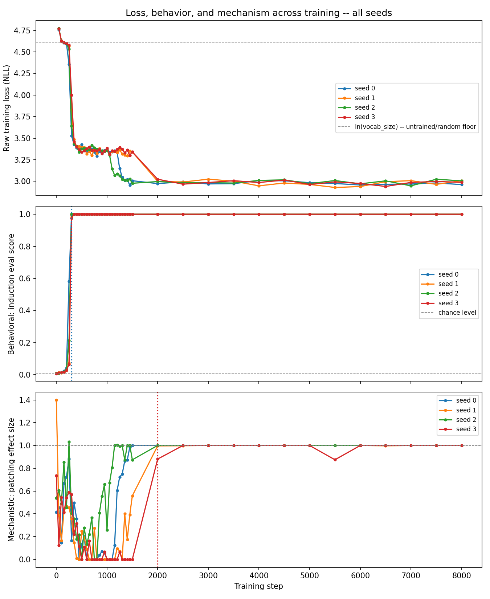
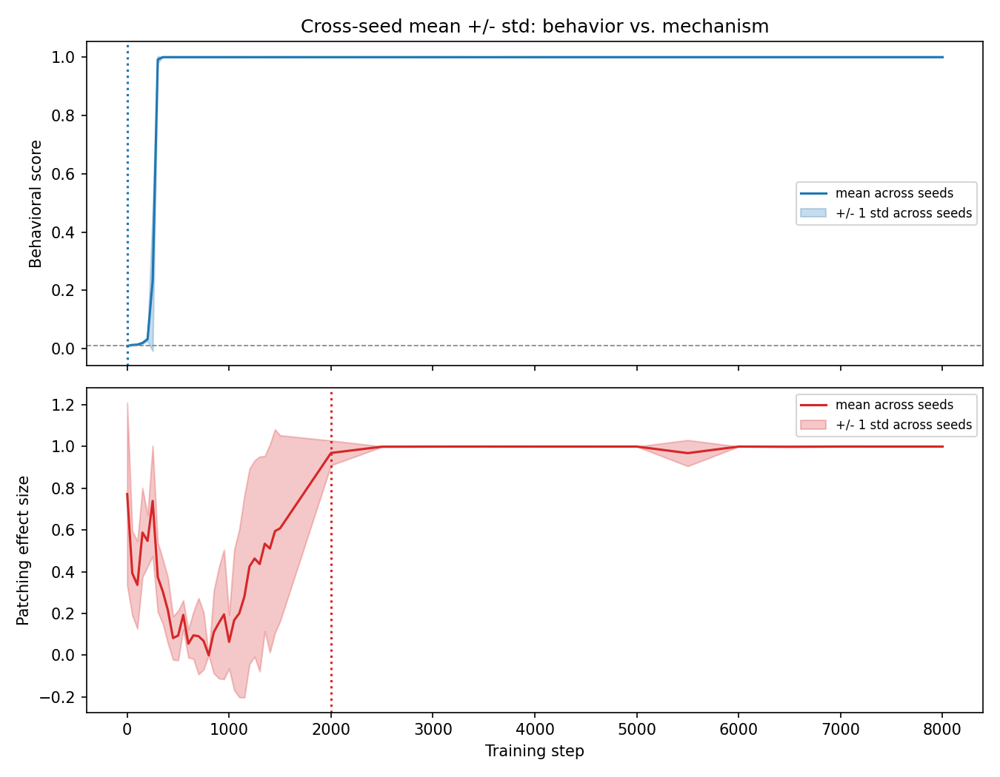
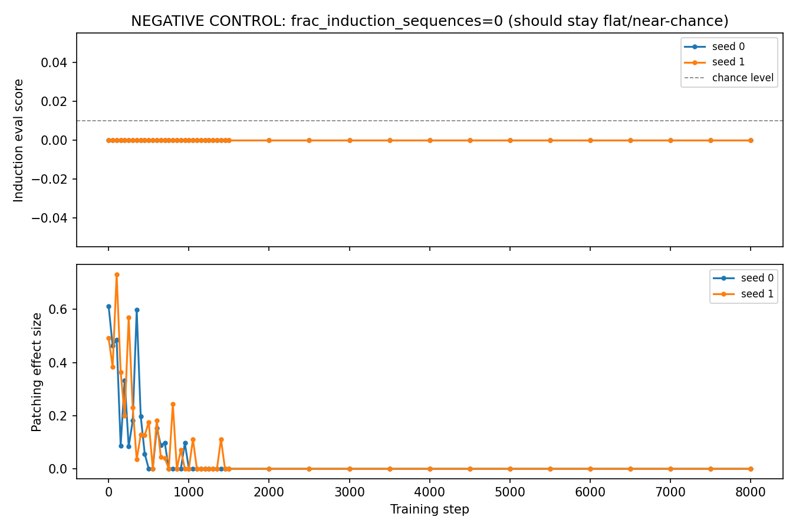
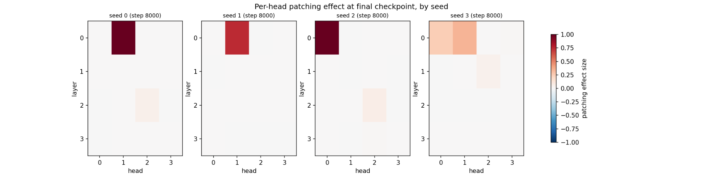
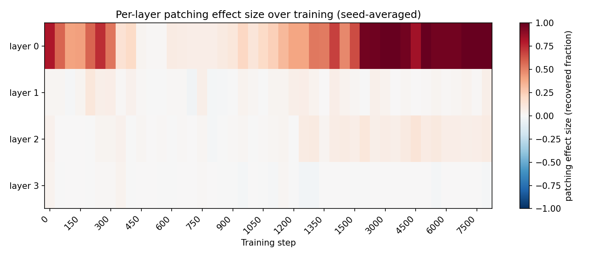
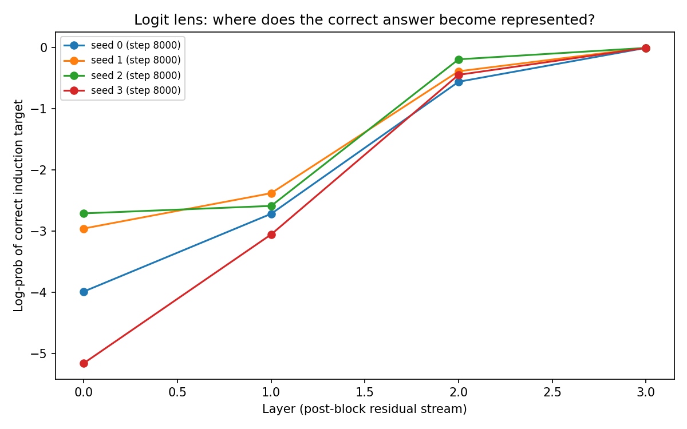
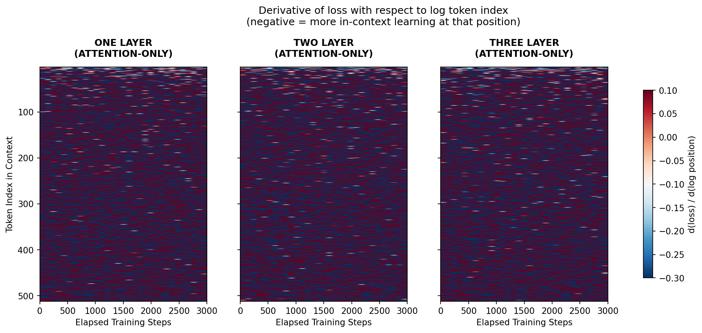
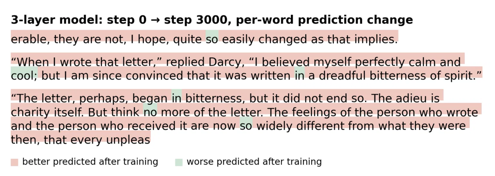

# 🔬 Behavioural and Mechanistic Measurements Diverge During Small-Model Training

## Overview

Behaviour–Mechanism is an empirical study of measurement agreement during capability development. Using induction learning as a controlled setting, the project tracks two views of the same learned capability throughout training: observable behavioural performance and a causal activation-patching measurement of the model's internal computation.

Rather than treating either measurement as a complete description of learning, the study examines how their trajectories relate across checkpoints and random seeds. It combines dense training measurements with a negative control, head-level localization, architecture variation, and a real-text extension to test whether the observed relationship survives several alternative explanations.

The central result is a persistent separation between the two measurement trajectories: behavioural performance stabilizes early, while the activation-patching measurement stabilizes substantially later. This makes induction learning a useful case study for a broader evaluation problem: different measurements of the same learned capability can support different conclusions about when that capability has stabilized.
<p align="center">
  
</p>

## Research Question

When behavioural performance and a causal mechanistic probe track the same learned capability across training, do they tell the same story about when that capability has stabilized?

In this controlled induction-learning setting, they do not.

Behavioural accuracy reaches ceiling within roughly 300–500 training steps across all four seeds. The activation-patching measurement follows a different trajectory, remaining substantially more variable beyond step 1,000 before reaching a sustained near-ceiling plateau around step 2,000.

The conclusion is deliberately narrow. Stable behavioural performance does not, by itself, establish that a particular mechanistic measurement has stabilized on the same timeline. Changes in circuit implementation and probe sensitivity remain plausible explanations for the observed mechanistic variability.

## Experimental Design

The main experiment trains a pre-LayerNorm decoder-only transformer from scratch on a synthetic induction task designed to make the target capability precisely measurable.

- 4 layers, 4 attention heads, `d_model=128`, `d_ff=512`
- Vocabulary size 100; sequence length 64
- 70% induction-structured sequences and 30% unstructured random sequences
- 8,000 training steps across seeds 0, 1, 2, and 3
- Dense checkpoints every 50 steps through step 1,500, then every 500 steps
- **Behavioural measurement:** next-token accuracy at induction-predictable positions
- **Mechanistic measurement:** fraction of the clean-vs-corrupted logit gap recovered by activation patching

The exact main-run configuration is preserved in [`configs/config.json`](configs/config.json).

## Main Result

Behaviour and mechanism separate during training.

Behavioural accuracy reaches `1.000` across all four seeds within roughly 300–500 steps and remains at ceiling. The activation-patching measurement does not settle on the same timeline: seed-level measurements continue to fluctuate substantially beyond step 1,000 before reaching a sustained near-ceiling plateau later in training.

<p align="center">
  
</p>

This distinction matters methodologically because a behavioural metric can appear completely settled while a causal probe of the same learned capability continues to change.

An earlier variance-only stability rule was rejected after it became clear that uniformly poor, floor-level performance could incorrectly satisfy the definition of "stable." The analysis was subsequently revised to require sustained near-ceiling performance. The research memo documents this correction, and the checkpoint-level measurements are included in the repository for independent inspection.

## Testing Alternative Explanations

### Negative Control

To test whether the patching pipeline could produce the observed pattern without induction learning, the same experiment was run with the induction structure removed (`frac_induction_sequences=0`).

These models never acquire the behavioural task. The patching measurement can still exhibit transient early effects, but those effects decay to zero rather than forming the sustained late-training plateau observed in the main condition.

<p align="center">
  
</p>

The control therefore argues against the sustained main-condition signal being explained solely by baseline behaviour of the measurement pipeline, while not ruling out every possible measurement artifact.

### Head-level localization

The final patching effect is also localized at the attention-head level.

<p align="center">
  
</p>

Three of four seeds concentrate most of the final patching effect in a single layer-0 attention head. The fourth seed distributes the effect across multiple heads and layers. This heterogeneity is retained rather than averaged away because it provides evidence that models with similar behavioural performance need not exhibit identical mechanistic localization.

### Architecture Robustness Probe

A small architecture scan tests whether the behavioural-mechanistic relationship persists across every configuration examined.

| `d_model` | Layers | Behavioural score | Patching effect |
| ---: | ---: | ---: | ---: |
| 64 | 2 | 1.000 | 0.088 |
| 128 | 4 | 1.000 | 1.000 |
| 256 | 4 | 1.000 | 1.000 |

All three configurations reach perfect behavioural accuracy by step 4,000, but the smallest configuration (`d_model=64`, 2 layers) has a final patching effect of only `0.088`.

Because width and depth change together, this result cannot identify the cause of the discrepancy. It instead motivates a controlled follow-up that varies width and depth independently.

## Additional Mechanistic Diagnostics

The analysis also tracks layer-level patching and logit-lens trajectories across training. These provide complementary views of how internal representations develop, but they are not used as the basis of the central stability result.

<p align="center">
  
</p>

<p align="center">
  
</p>

## Real-text Extension

The primary experiment deliberately uses a synthetic task so that the target behaviour is unambiguous and inexpensive to measure. A complementary experiment tests related induction-head diagnostics in a natural-language setting using 1-, 2-, and 3-layer attention-only character models trained on the public-domain text of Jane Austen's *Pride and Prejudice*.

The depth-dependent diagnostic from the original induction-head work does **not** reproduce cleanly at this model scale and 3,000-step training budget. This null result is retained rather than omitted.

<p align="center">
  
</p>

Separately, the trained 3-layer model shows substantial prediction improvement on a held-out passage. Under the chosen loss-improvement threshold, 93.7% of positions improve meaningfully, while mean loss falls from 4.626 to 2.443.

<p align="center">
  
</p>

This establishes that the model learns meaningful structure from the real-text corpus. It does **not** establish that an induction circuit causally produced those improvements.

## What the evidence supports:

The experiments establish that:

- Behavioural induction performance reaches ceiling substantially earlier than the activation-patching measurement reaches a sustained near-ceiling plateau in this controlled small-model setting.
- A matched negative control does not reproduce the sustained late-training patching plateau.
- Mechanistic localization differs across random seeds despite similar final behavioural performance.
- A smaller tested architecture exhibits a pronounced behavioural/probe discrepancy that motivates controlled architecture follow-up experiments.

The experiments do **not** establish that:

- The underlying mechanism itself is necessarily unstable whenever the patching measurement is unstable.
- Width, depth, or scale individually explains the `64/2` architecture result.
- The observed separation generalizes directly to frontier models or safety-relevant capabilities such as refusal, deception, or situational awareness.
- The real-text extension constitutes a causal replication of an induction circuit.

## Why this matters

Behavioural evaluation tells us **what a model does**. Mechanistic measurement attempts to tell us something about **how the model produces that behaviour**.

In this experiment, those two views do not settle on the same training timeline. A model can therefore appear behaviourally stable while a causal mechanistic measurement of the same capability continues to change.

The broader implication is not that behavioural evaluation is unreliable, or that mechanistic measurements should automatically take precedence. It is that **behavioural stability alone may not provide a complete picture of how a learned capability develops during training.**

## Code and data

This repository contains the experiment notebook, main-run configuration, checkpoint-level behavioural and mechanistic measurements, negative-control outputs, architecture scan, analysis data, figures, and research memo supporting the reported results.

Large model checkpoints and serialized training states are intentionally excluded. The notebook was developed in Google Colab using JAX/Flax and contains the experimental and analysis pipeline.

## Repository Structure

```text
behaviour-mechanism/
├── configs/
│   └── config.json
├── figures/
│   ├── behavior_vs_mechanism.png
│   ├── induction_schematic.png
│   ├── logit_lens.png
│   ├── negative_control.png
│   ├── per_head_final.png
│   ├── per_layer_patching.png
│   ├── real_text_depth.png
│   ├── real_text_qualitative.png
│   └── variance_bands.png
├── notebooks/
│   └── behaviour_vs_mechanism.ipynb
├── paper/
│   └── behavior_mechanism_research_memo.pdf
├── results/
│   ├── behavior.csv
│   ├── mechanistic.csv
│   ├── merged.csv
│   ├── negative_control.csv
│   ├── per_layer_patching.csv
│   ├── scale_scan.csv
│   └── variance_by_step.csv
├── .gitignore
├── README.md
└── requirements.txt
```

## Research Memo

The full experimental design, measurement methodology, results, controls, robustness analyses, limitations, and proposed follow-up experiments are documented in the [**preprint**](paper/behaviour_mechanism_preprint.pdf).

The preprint is also archived on **Zenodo**, providing a persistent, citable record of this work: **[Zenodo preprint](https://doi.org/10.5281/zenodo.22602752)**.

## References

This study builds on prior work on induction heads and causal interventions in transformer internals, particularly:

- Olsson et al. (2022), *In-context Learning and Induction Heads*.
- Meng et al. (2022), *Locating and Editing Factual Associations in GPT*.
- Vig et al. (2020), *Causal Mediation Analysis for Interpreting Neural NLP: The Case of Gender Bias*.
